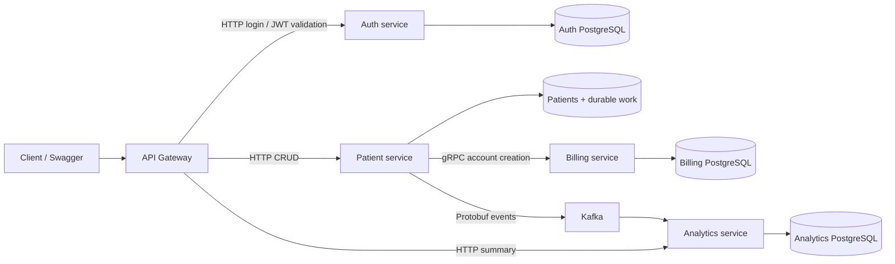

# Patient Management

[](https://github.com/rafag6320/patient-management/actions/workflows/verify.yml?query=branch%3Amain)

An educational Java 21 / Spring Boot backend for patient records, billing accounts,
and event-based registration analytics. Extended from a course project to explore
persistence, failure recovery, and automated verification across service boundaries.

**Start here:** [demo guide — español](docs/demo.md) · [API / Swagger guide — español](docs/swagger.md) ·
[releases and verification](https://github.com/rafag6320/patient-management/releases).

Billing creates accounts; it does not implement invoices, payments, or balances.
All demo data is synthetic.

## What you can demonstrate

- Patient CRUD with validation, database uniqueness constraints and controlled errors.
- JWT login and gateway authorization: ADMIN can write; USER can read.
- Persistent billing accounts created through gRPC, idempotent by patientId.
- Durable registration work: patient and delivery intent are committed locally;
  interrupted billing/event delivery can resume after a restart.
- Optional Idempotency-Key to recover the same registration after an uncertain result.
- Kafka events with a persistent, deduplicated historical count in analytics.
- Flyway migrations, isolated tests, real PostgreSQL checks and full-system acceptance.
- Central Swagger UI and explicit HTTP / gRPC contract documentation.

## Architecture



Each service owns its data. A successful registration confirms the patient, its
billing account and durable event intent. Kafka delivery and analytics follow
asynchronously. A timeout does not mean that all previous work was rolled back.

Microservices are an intentional learning choice here: they expose network
failures and consistency boundaries. A modular monolith would be a simpler
operational alternative for this small functional scope.

## Technology choices and trade-offs

| Technology | Use and reason | Trade-off |
| --- | --- | --- |
| Java 21 / Spring Boot | Dependency injection, validation, HTTP services and configuration | Framework conventions and dependency compatibility need explicit verification |
| PostgreSQL + JPA / JDBC | Local transactions, uniqueness and service-owned persistent data | Separate databases prevent a single transaction across the whole registration |
| Flyway | Versioned SQL and explicit adoption of existing schemas | Schema changes need migration and backup planning |
| REST + OpenAPI | Client-facing API and an executable API catalog | Explicit catalogs must stay aligned with behavior |
| gRPC + Protobuf | Typed internal account-creation contract | Code generation, deadlines and RPC error handling add complexity; REST is an alternative |
| Kafka | Decouple registration from analytics and retry delivery later | Eventual consistency and redelivery require idempotent effects |
| Docker Compose | Reproducible services, databases and broker | Ten containers need local resources; this is not production orchestration |
| JUnit / Mockito / Spring Test / Rest Assured | Unit, isolated-context, database and system verification | Mocks and H2 do not replace real PostgreSQL/Kafka checks |
| GitHub Actions | Run checks and preserve reports for a specific revision | A green run verifies its commit and scenarios, not production readiness |
| AWS CDK / LocalStack | Test infrastructure templates and bounded local emulation | AWS is not deployed; LocalStack only checks CloudFormation and a synthetic secret |

Version and configuration details are in the [architecture](docs/architecture.md)
and [environment guide](docs/environments.md). No AWS account is needed for the demo.

## Quick start

Requirements: Git, **PowerShell 7**, Docker Engine with Linux containers, and
**Docker Compose >= 2.24.4**. Docker builds download Java/Maven and dependencies;
an internet connection is required on the first run. A host JDK is only needed
for the Maven verification scripts, not for the Docker demo.

```powershell
git clone https://github.com/rafag6320/patient-management.git
cd patient-management
pwsh -File ./scripts/demo.ps1 -Action Start
pwsh -File ./scripts/demo.ps1 -Action Run
```

Open [Swagger UI](http://127.0.0.1:44004/swagger-ui.html). The isolated development
seed uses `testuser@test.com` / `password123`. These are demo-only values, never
production credentials. The script keeps its JWT in memory and does not print it.

Run checks authentication, registration, replay, a billing outage, a patient
restart and eventual recovery. Only the gateway is published, on loopback. The
demo owns its containers and volumes and does not reuse your normal Compose data.

```powershell
# Stop the demo; keep its volumes for a later Start.
pwsh -File ./scripts/demo.ps1 -Action Stop
```

See the [Spanish demo guide](docs/demo.md) for expected output, prerequisites,
failure handling and Swagger usage.
For an existing installation, follow [migration adoption](docs/migrations.md)
before starting it; never delete its volumes to bypass a migration error.

## Verification

With a host JDK 21 and PowerShell 7:

```powershell
./scripts/verify.ps1 -WithContexts
./scripts/verify-migrations-postgres.ps1
./scripts/verify-billing-postgres.ps1
./scripts/verify-recovery-postgres.ps1
./scripts/verify-system.ps1
```

The [CI workflow](.github/workflows/verify.yml) also tests/synthesizes infrastructure,
checks the bounded LocalStack scenario and runs the isolated demo. It retains
reports even if a check fails. Release notes link the exact tagged commit and
its successful run; the badge above tracks the latest main run.

Tests cover validation, conflicts, roles, contracts, RPC deadlines, lost replies,
duplicate events and restart recovery. See [local verification](docs/local-development.md)
for the complete test matrix.

## Origin and subsequent improvements

The educational starting point is Chris Blakely's
[Java/Spring microservices course](https://www.youtube.com/watch?v=tseqdcFfTUY)
and [original source repository](https://github.com/chrisblakely01/java-spring-microservices).

Original course notice: **Copyright © 2025 Code Jackal | Original Course Material by Chris Blakely**.
The initial service structure, CRUD and communication mechanisms come from that
learning base. This repository does not claim original authorship of the course.

Subsequent work includes persistent/idempotent billing, Flyway migrations, durable
registration recovery, analytics deduplication/quarantine, role authorization,
expanded tests, CI, deployment preparation and centralized API documentation.

Development was assisted by Codex. Technical choices, implementation and
verification are documented so the result can be inspected and explained.
No new license is assigned.

## Limits and further reading

- No real AWS deployment or production operation is claimed. CDK synthesis does
  not verify effective cloud IAM, networking or service availability.
- Authorization is enforced at the gateway; internal services need private networking.
  Internal HTTP/gRPC does not use mTLS.
- Delivery may repeat; deduplication protects the analytics effect. There is no
  distributed transaction or exactly-once guarantee.
- Analytics counts historical registrations, not active patients. Patient updates
  and deletions do not synchronize billing snapshots or decrement that total.
- Snapshot retention/purge and historical reconciliation remain future work.
- The supplied development settings and seed must not be exposed as a public service.

Technical guides (Spanish): [architecture](docs/architecture.md),
[decisions](docs/decisions.md), [registration semantics](docs/patient-registration-semantics.md),
[recovery operations](docs/recovery-operations.md), [AWS preparation](docs/aws-deployment.md)
and [roadmap](docs/roadmap.md).
