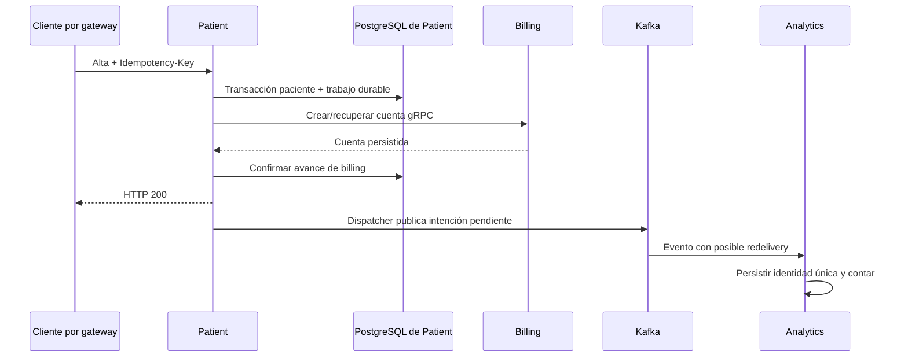

# Demo de portfolio — Patient Management

## Propósito y requisitos

Backend educativo para postulaciones Java junior. No es un producto clínico ni
requiere AWS. Todos los pacientes de la demo son sintéticos.

Requisitos: Git, PowerShell **7**, Docker Engine con contenedores Linux y Docker
Compose **2.24.4 o superior**. El primer build necesita internet para imágenes y
dependencias. No se necesita JDK en el host para la demo; Java/Maven se ejecutan
en las imágenes. Los tests Maven del host sí requieren JDK 21.

Se inician diez contenedores: cinco aplicaciones, cuatro PostgreSQL y Kafka.
Los límites de aplicaciones y Kafka suman aproximadamente 4.1 GiB, además de
PostgreSQL, builds y Docker. Esto no es un benchmark ni un mínimo de hardware.
Dejar memoria adicional disponible y revisar los recursos de Docker ante fallos.

## Inicio, ejecución y parada

Desde un clon limpio:

```powershell
pwsh -File ./scripts/demo.ps1 -Action Start
pwsh -File ./scripts/demo.ps1 -Action Run
# Después de explorar Swagger:
pwsh -File ./scripts/demo.ps1 -Action Stop
```

Start construye imágenes y espera los healthchecks; el primer inicio puede
llevar varios minutos. Swagger queda en <http://127.0.0.1:44004/swagger-ui.html>.
Run deja las aplicaciones activas. Stop retira sólo contenedores/red de la demo,
conservando sus cinco volúmenes y su identidad para otro Start. Cada Run crea
pacientes y claves nuevos. No ejecutar acciones simultáneas.

El proyecto exclusivo pm-demo-... se registra en `.verification/demo/state.json`,
asociado a este checkout. Los recursos llevan una etiqueta de propiedad, validada
antes de operar. No editar ni copiar el estado a otra carpeta. Sólo el gateway
se publica en loopback; el override reemplaza las publicaciones originales.

Un puerto 44004 ocupado, un estado inválido o recursos sin identidad bloquean
la acción sin detener otro entorno. Si se interrumpe la consola, ejecutar Start
antes de Run; el trabajo durable puede terminar al recuperarse billing. No hay
acción de borrado de datos. No usar `down -v` ni borrar volúmenes ante errores.

## Escenarios y resultados esperados

| Paso | Resultado |
| --- | --- |
| Pacientes sin JWT | HTTP 401 |
| Login con fixture local | HTTP 200; JWT sólo en memoria |
| Alta con Idempotency-Key | HTTP 200 al confirmar billing; 503 se reintenta con la misma entrada |
| Repetición | Mismo ID y una cuenta billing |
| Kafka / analytics | Un efecto persistido y total histórico +1 |
| Billing detenido | HTTP 503 acotado y trabajo pendiente persistido |
| Reinicio de patient y restauración de billing | Mismo ID, una cuenta y un efecto de analytics |

Las cuentas y eventos se comprueban con SQL de sólo lectura dentro de sus bases.
Son comprobaciones externas de demo; los servicios no acceden a bases ajenas.
El total se compara con el inicial para permitir ejecuciones repetidas. Un finally
restaura billing cuando falla el escenario. Se esperan hasta 120 segundos por
resultado eventual y hasta 12 segundos por petición HTTP.

Un fallo devuelve salida 1; la salida 0 significa que pasó esa acción. Ejemplo:

```text
OK: acceso sin JWT rechazado (HTTP 401).
OK: patient=<uuid>; cuenta billing=1; efecto analytics=1; total=<n>.
OK: alta y repetición idempotente (HTTP 200, mismo ID).
OK: billing detenido devuelve HTTP 503 y conserva el alta pendiente.
OK: reinicio, recuperación y nueva repetición conservan el mismo ID y efectos únicos.
```

Cada acción guarda un reporte sanitizado report-*.json en `.verification/demo`.
El diagnóstico Compose queda local en compose.log y no se adjunta al artefacto
público de demo. No se imprime el JWT ni la configuración interpolada. Revisar
cualquier log privado antes de compartirlo.

## Swagger

1. Abrir la UI y elegir **API publica (gateway)**.
2. Ejecutar `/api/auth/login` con `testuser@test.com` / `password123`, fixture de
   desarrollo existente. No son credenciales productivas.
3. Pegar el token en **Authorize**, sin prefijo Bearer. No incluirlo en capturas.
4. Consultar `/api/patients` y `/api/analytics/summary`.
5. Para un alta manual usar una nueva clave; conservar clave y payload si hay 503.

No modificar datos manualmente durante Run: espera incrementos conocidos del
contador. Los catálogos internos documentan contratos sin publicar sus puertos.
Billing es gRPC, no una operación HTTP ejecutable en Swagger.
Campos, roles y errores: [swagger.md](swagger.md).

## Flujo y guion de cinco minutos



El 200 confirma paciente, cuenta e intención durable; no espera Kafka/analytics.
Un 503 puede dejar un paciente visible: no hay rollback global. El dispatcher
recupera el avance; billing y analytics evitan duplicar efectos. No se promete
exactly-once. Ver [semántica del alta](patient-registration-semantics.md).

| Tiempo | Contenido |
| --- | --- |
| 0:00–0:45 | Problema, alcance educativo y atribución al curso de Chris Blakely. |
| 0:45–1:30 | Diagrama: REST, RPC y eventos posteriores. |
| 1:30–2:15 | Swagger, autenticación y alta idempotente. |
| 2:15–4:00 | Demo/reporte de fallo y recuperación; explicar el resultado incierto. |
| 4:00–5:00 | Test de recuperación, CI del release, límites y mejoras posteriores. |

Construir las imágenes antes de presentar. El lease/backoff puede prolongar la
recuperación: para un video corto se puede mostrar un reporte de la misma versión,
aclarando que es evidencia anterior. La grabación no forma parte de esta entrega.

## CV e entrevista

Texto sugerido en inglés, ajustándolo a lo que se pueda defender personalmente:

> **Patient Management — Java Backend Portfolio Project**
>
> Extended a Java/Spring Boot course project with persistent, idempotent billing,
> Flyway migrations, durable registration recovery and deduplicated Kafka analytics.
> Added automated unit, integration and failure-recovery checks, GitHub Actions and
> centralized API documentation. Prepared AWS CDK templates; no live AWS deployment
> is claimed. Development assisted by Codex.

Enlazar repositorio/release desde el CV. No inventar experiencia productiva,
cantidades de usuarios ni mejoras de rendimiento sin mediciones.

Preparar estas respuestas con ejemplos del código:

- DTO versus UNIQUE: servicio de pacientes, repositorio y carrera concurrente.
- Límite de una transacción: RegistrationStore no confirma gRPC ni Kafka.
- Timeout con cuenta creada: LostReplyIntegrationTest y unicidad por patientId.
- Garantía del 200: RegistrationCoordinator y la semántica del alta.
- Repetición de POST: clave, fingerprint, snapshot y conflictos.
- Repetición de evento: AnalyticsStore y restricción única del efecto.
- Qué cubre H2 y qué exige PostgreSQL/Kafka: [grupos de tests](local-development.md).
- Microservicios versus monolito modular: aprendizaje y costos de operación.
- Base del tutorial versus mejoras posteriores: historial, decisiones y revisión
  del trabajo asistido por Codex.

